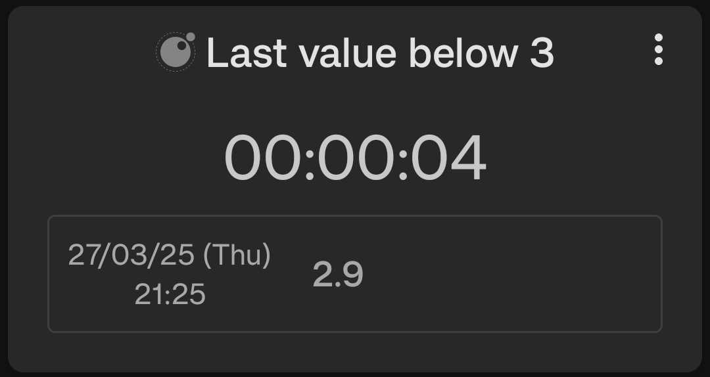

---
search:
  exclude: true
---

# Last Value Below Threshold

!!! warning "Deprecated documentation"
    This page describes the older single-file Lua graph workflow. It is retained for existing users and is no longer maintained. [Current documentation](../../../../community/index.md).


This script returns the last datapoint with a value below a given threshold. It can accept multiple data sources.

<div style="text-align: center;">
    
</div>

## Configuration

This script accepts the following configuration parameters:

```lua
-- The threshold below which the last value is returned
local threshold = 0
```

[Install via deeplink](trackandgraph://lua_inject_url?url=https://raw.githubusercontent.com/SamAmco/track-and-graph/refs/heads/master/docs/docs/lua/deprecated/community/datapoint/last-value-below-threshold/script.lua)

[Read the full script](./script.lua)

Author: [SamAmco](https://github.com/SamAmco)
